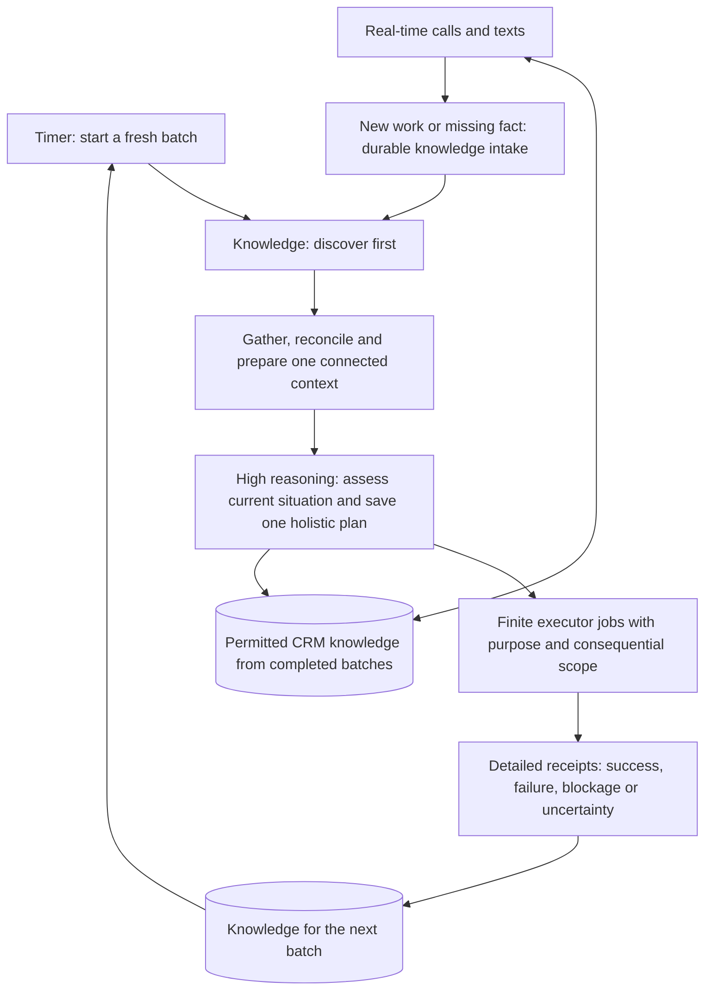

# Design for Batch

The goal is human attention released from work completely. An assistant owns thoughtful finished outcomes, while each batch remains a fresh, self-contained assessment.

## Every batch stands on its own

The timer is a rhythm for reassessment, such as :00 and :30. One decision owner considers all available knowledge together. Finish the present assessment without starting a competing one. End the reasoning session after its finite assignments. A later batch reasons about the current situation rather than automatically continuing the old plan. Commitments persist as knowledge, not long-running business states.

## Knowledge belongs to the reasoner

Discovery is FIRST. Look for what changed, missing context and newly useful sources. A device receipt can reveal an unfamiliar stream; investigate actual authorized access rather than wait for the human to reprogram a feed checklist. Gather original bodies, including outgoing replies. Prepare one interconnected context with identities, dates, relationships, commitments, source coverage and explicit gaps. The model platform performs tokenization; the executive owns context coherence and selection.

The Knowledge Phase is visible to the builder before the main high-reasoning planning phase, although the same executive directs both.

## Reason, then execute

Give a capable frontier model high reasoning effort and time for useful multiple passes. The first planning output is one whole-batch plan. Delegates receive purpose, permitted tools and consequential scope. Ordinary details remain judgment, not exact-match sentence templates. No helper can choose a new executive strategy.

Every attempt returns a receipt with actual effects and uncertainty. The next batch judges that evidence in context. A failed receipt does not trigger immediate replanning. Unused capabilities are evidence, not a code-selected business failure. A worker finishing does not prove the work is finished.

## No exceptions

All substantive work is batched. Only calls and texts have real-time conversation, using permitted preexisting CRM knowledge from completed batches. No fresh fact lookup. Missing knowledge and new work wait for the next batch. Email is entirely batched. Urgent labels, legacy workflows and failed tools cannot create a business-work bypass.

Conversation naturally accepts responsibility and can offer a reasonable notification estimate. It never claims unperformed work is already done. No hardcoded acknowledgment script or guaranteed 45-minute result is required.

## Autonomy and evolution

Ordinary proposals are prepared and sent under standing authority. Review is not the default destination. Escalate when the principal is genuinely needed. Preserve useful new knowledge despite yesterday’s incomplete fields; let the assistant administer its CRM and improve the structure. Learn general practices from outcomes and feedback, not named-person patches.

Source refresh cadence can differ from executive cadence. Our personal Apple Messages reservoir refreshes once daily at 3 a.m. America/New_York and is discovered at 3:30. New source access must actually exist; a discovery lead is not permission.

## Acceptance cases

- A refund reminder without an external participant receives executive assessment.
- Outgoing replies change the interpretation of incoming requests.
- A transcript supplies a relationship fact that supports a later natural CRM-based conversation.
- A new device receipt prompts source discovery without inventing access.
- A proposal is completed and sent within scope, not returned as an unsolicited draft.
- Failure produces a receipt and no immediate recovery session.
- The next batch sees unfinished commitments and chooses afresh.
- Quiet batches do not erase relationship memory.
- New CRM fields do not require the principal to be DBA.
- Calls and texts remain responsive; no substantive worker starts before the batch plan.

## Evaluate the result

Measure finished outcomes, missed commitments, corrections, operating cost and unnecessary interruptions over the same day. Judge conversation latency separately. Improved quality, cost and effectiveness are a thesis to test, not an established benchmark.

[Full article](https://johnrector.me/2026/11/19/design-for-batch/) · [AI build brief](static/design-for-batch.md)
