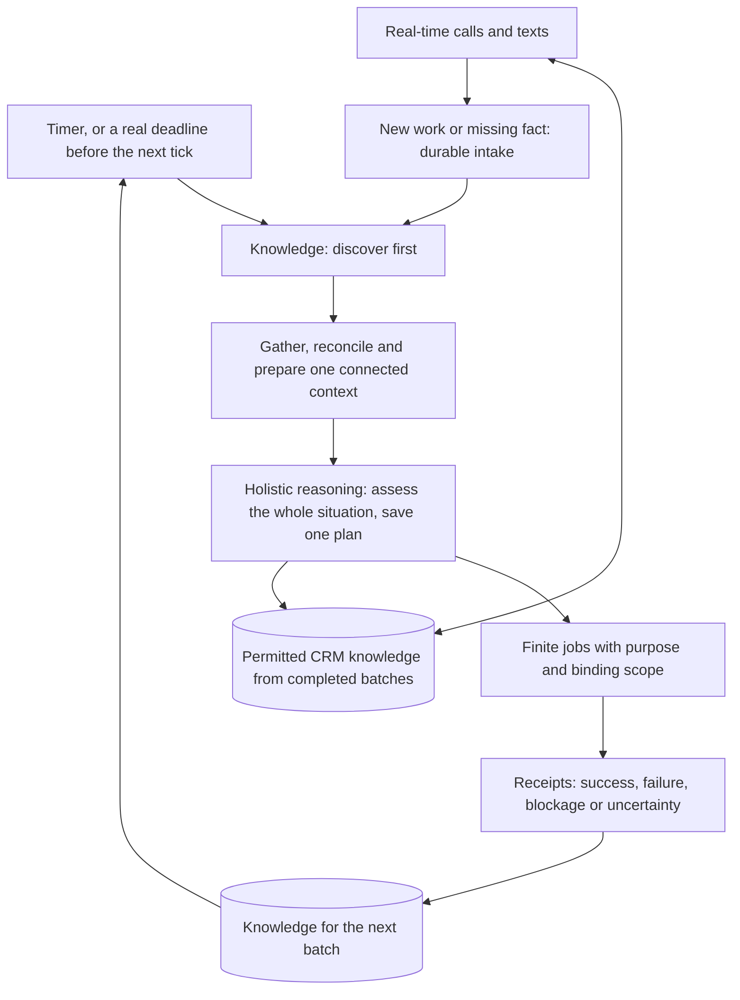

# Design for Batch

The goal is human attention released from work completely. An assistant owns thoughtful finished outcomes, while each batch remains a fresh, self-contained assessment.

## The idea in six sentences

1. A timer starts a batch; no human prompt is needed.
2. One executive reasoner discovers what matters, prepares one connected context, reasons about the whole situation and saves one plan.
3. Finite jobs carry out the plan and return receipts, including failure.
4. Receipts become knowledge for the next batch, which assesses afresh.
5. No work happens outside a batch. Calls and texts stay conversational from knowledge earlier batches published.
6. Done means the outcome in the world, not a draft or a dispatch.

## A deadline can move the clock, never the owner

When intake carries a real deadline that falls before the next scheduled batch could act on it, the next batch starts early. It is a full batch that considers everything pending, not a worker for one request. "Urgent" is a label; a deadline is a time the outcome must land by.

## Where this is wrong

One executive is one point of failure. A whole life may not fit one context. Standing authority means mistakes go out finished. Better whole-day quality, cost and effectiveness are a thesis to test, not an established result.

The canonical version is the [AI build brief](static/design-for-batch.md). The [full article](https://johnrector.me/2026/11/19/design-for-batch/) has the argument, the diagram and our own implementation.
